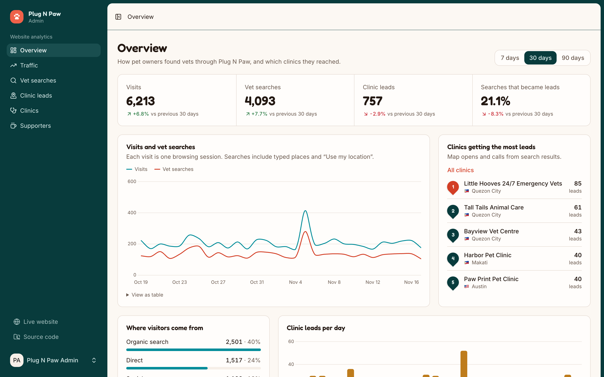
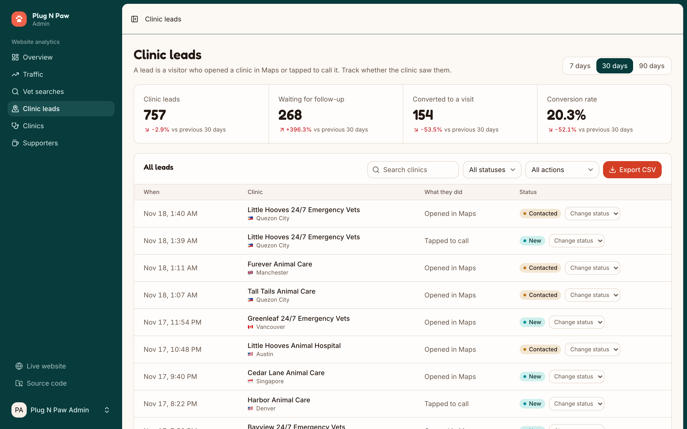
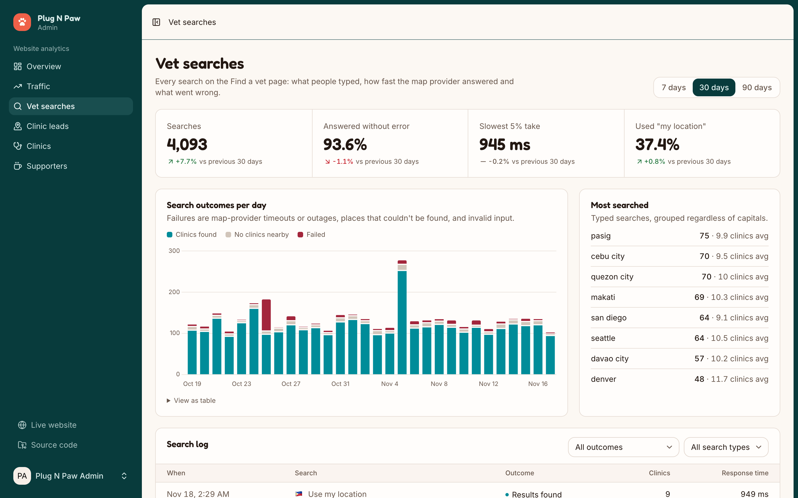
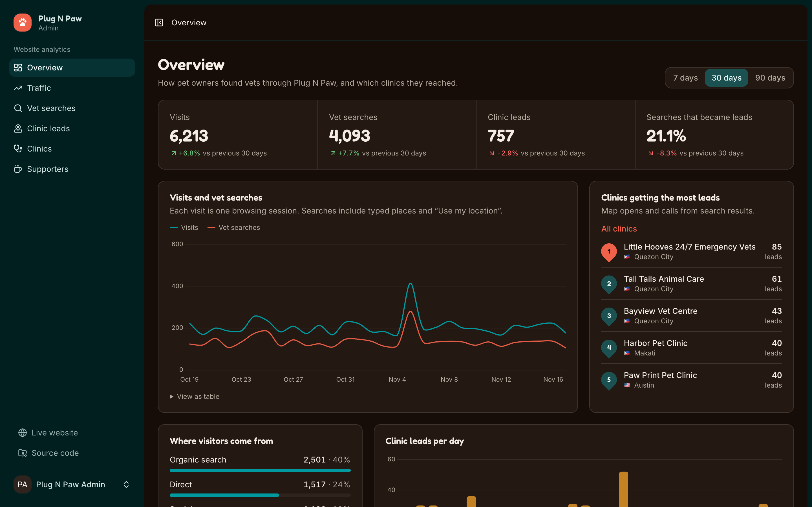
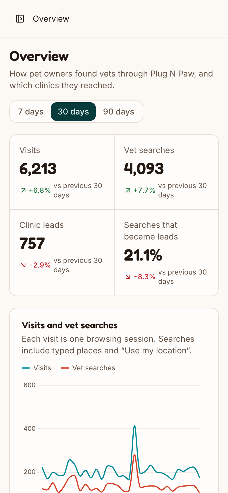

# Plug N Paw Admin

[](https://github.com/jaybecina/plug-n-paw-dashboard/actions/workflows/tests.yml)

The analytics back office for **[Plug N Paw](https://plug-n-paw-web.vercel.app)**, a vet finder that helps pet owners find nearby clinics. It shows the site's traffic, every vet search, and the **clinic leads** those searches produce (visitors who opened a clinic in Maps or tapped to call it).

Built with **Laravel 13, Inertia 3, Vue 3 (TypeScript) and SQLite**.

**Live demo:** https://plug-n-paw-admin.onrender.com. It runs on a free server, so the first load can take about 30 seconds.



| Clinic leads                         | Vet searches                               | Dark mode                                   | Phone                                           |
| ------------------------------------ | ------------------------------------------ | ------------------------------------------- | ----------------------------------------------- |
|  |  |  |  |

## What's inside

| Page             | What it answers                                                                                                                                     |
| ---------------- | --------------------------------------------------------------------------------------------------------------------------------------------------- |
| **Overview**     | How many people visited, searched for a vet and became a clinic lead, compared with the previous period. Also the top clinics and the latest leads. |
| **Traffic**      | Visits per day, sources (organic, social, referral…), devices, countries, landing pages and bounce rate.                                            |
| **Vet searches** | Search outcomes per day (found, empty, failed), the most searched places, the slowest 5% of responses, and a filterable log.                        |
| **Clinic leads** | Every Maps or call click. Filter, move each lead through _new → contacted → converted / lost_, and export to CSV.                                   |
| **Clinics**      | Every clinic ranked by leads, calls and conversion rate.                                                                                            |
| **Supporters**   | Ko-fi gifts: total raised, average gift, monthly share and a monthly chart.                                                                         |

Every page has a **7 / 30 / 90 day** filter and compares against the period just before it.

## Quick start

You need **PHP 8.4+**, **Composer** and **Node 22+**. Nothing else: the database is a SQLite file.

```bash
git clone https://github.com/jaybecina/plug-n-paw-dashboard.git
cd plug-n-paw-dashboard
composer setup   # installs, creates .env + database/database.sqlite, migrates, seeds, builds
composer dev     # app on http://localhost:8000 with Vite hot reload
```

Log in with **admin@admin.com** / **password123** (the local defaults from `.env.example`).

### Demo data: what a clone gets

The SQLite database file is **not** in Git (`database/*.sqlite` is ignored, which is good practice: no binary blobs or personal data in history). What's committed is the **migrations, factories and seeders** that rebuild it.

```bash
php artisan demo:seed        # wipe and rebuild the demo database (asks first in production)
php artisan demo:seed --force
```

The seeder produces **180 days** of realistic activity (about 2.2k visits, 1.4k searches and 250 clinic leads, or under 500 visits a month, like a small site with no marketing). It includes weekly seasonality, growth, three viral social posts and one map-provider outage. It's **deterministic**: it uses a private seeded random engine, and dates are relative to _today_. Everyone who clones the repo sees exactly the same numbers, and the charts never look stale.

## Authentication

- **Log in** and **forgot password** come from Laravel Fortify. Two-factor login and passkeys are available too.
- **Sign-up is turned off.** Only seeded admins can get in, and every analytics route checks a `view-analytics` gate.
- **Admin account:** set by `ADMIN_EMAIL`, `ADMIN_PASSWORD` and `ADMIN_NAME` in `.env`, created by `AdminUserSeeder`.
- **Reset emails** use `MAIL_MAILER=log`. Open the reset link from `storage/logs/laravel.log`.
- **Demo mode** (`DEMO_MODE=true`, used on the public deployment) refuses password, profile, 2FA, passkey and delete-account changes, so one visitor can't lock out the next.

## How it's built

```
app/
├── Enums/                 # TrafficSource, Device, SearchType, SearchStatus, LeadAction, LeadStatus, Period
├── Queries/Analytics/     # one query class per page: KPIs, zero-filled daily series, breakdowns
├── Support/               # DateRange (+ previous period), Delta, Kpi, Series, CsvSafe
├── Http/Controllers/Analytics/   # thin, invokable controllers → Inertia pages
├── Http/Requests/         # AnalyticsRequest (range/filters with safe fallbacks), UpdateLeadStatusRequest
├── Http/Middleware/PreventDemoChanges.php
├── Policies/ClinicLeadPolicy.php
└── Console/Commands/DemoSeedCommand.php
database/seeders/DemoDataSeeder.php   # deterministic 180-day generator
resources/js/
├── pages/                 # Dashboard + analytics/{Traffic,Searches,Leads,Clinics,Supporters}
├── components/analytics/  # KpiStrip, AnalyticsChart, RankedBars, ClinicLeaderboard, DataTable…
└── composables/           # useChartTheme (light/dark for canvas), useQueryFilters
```

Some decisions worth calling out:

- **Controllers stay thin.** Each page's numbers come from a query class that returns plain arrays. They're easy to unit-test and easy to read.
- **Comparisons are built in.** `DateRange` knows its previous period. KPIs carry `value`, `previous`, `delta` and whether higher is better, so the UI colours change correctly. For example, a rising bounce rate shows red.
- **Fast enough without a cache.** SQLite with indexed timestamps answers each page in under 25 ms on the full seed. The 95th-percentile response time is computed in SQL, without loading every row.
- **Bad URLs don't break pages.** Unknown `?range=` or filter values fall back to defaults instead of erroring.
- **Safe CSV export.** It's streamed in chunks and neutralises spreadsheet formulas (CSV injection).
- **Accessible charts.** Chart colours come from a fixed categorical order, checked for colour-blind separation in light and dark. Every chart has a legend and a "View as table" fallback.
- **Typed routes.** Wayfinder generates TypeScript route helpers, so the front end has no hard-coded URLs.

## Quality checks

```bash
composer test       # Pint (style) + Larastan level 7 + Pest
composer ci:check   # the above + frontend lint/format + vue-tsc
```

The suite has 85 Pest tests. They cover the auth and admin gate, demo mode, every page's props, empty databases, invalid filters, lead updates, CSV export (including formula injection), date-range maths, and seeding determinism. GitHub Actions runs them on PHP 8.4 and 8.5, then builds the production Docker image and boots it.

## Deploy for free (Render)

The repo includes a `Dockerfile` (FrankenPHP, PHP 8.4) and a `render.yaml` Blueprint.

1. Push to GitHub.
2. In [Render](https://render.com), go to **New → Blueprint** and pick this repo. The free plan needs no credit card.
3. Render generates `APP_KEY` and provides the public URL. It asks for one value, `ADMIN_PASSWORD`: type the password you want for the admin login. It's kept in Render, not in this public repo.

On every boot the container caches config, routes and views, runs `demo:seed --force` for a fresh demo database, and serves on Render's port. Free instances sleep after about 15 idle minutes, so the next visit takes roughly 30 seconds to wake. That's fine for a portfolio, and every visitor gets clean data.

**Why not Vercel?** Vercel has no PHP runtime of its own, and its filesystem is read-only, so SQLite writes (logins, lead updates) wouldn't persist. Render runs the app as a normal server. To move to an always-on host later, [Laravel Cloud](https://cloud.laravel.com) runs the same code unchanged.

## Project docs

- Design spec: [`docs/superpowers/specs/2026-11-18-plug-n-paw-dashboard-design.md`](docs/superpowers/specs/2026-11-18-plug-n-paw-dashboard-design.md)
- Implementation plan: [`docs/superpowers/plans/2026-11-18-plug-n-paw-dashboard.md`](docs/superpowers/plans/2026-11-18-plug-n-paw-dashboard.md)

## License

MIT
